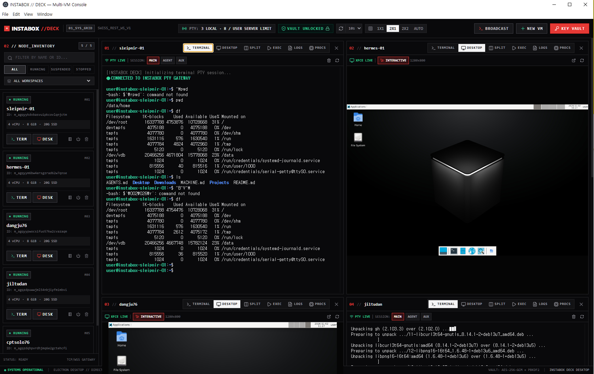

# InstaDesk



## English

**InstaDesk** is a desktop app for managing [InstaBox](https://instabox.sh) virtual machines with your own API key. Add a key, see the VMs available to its workspace, and work with terminals, desktops, and commands from one window.

**Download:** [InstaDesk v2.1.1](https://github.com/Yupkidangju/instadesk/releases/tag/v2.1.1) · Windows x64 · Linux x64 · Linux arm64

### Install

**Windows:** Download `InstaDesk-2.1.1-win-x64.zip`, extract the whole archive, and run `InstaDesk.exe` inside the extracted folder.

**Linux:** Download the `linux-x64` or `linux-arm64` archive for your machine. In the download directory, run the following commands, replacing `x64` with `arm64` when needed:

```bash
name=InstaDesk-2.1.1-linux-x64
sudo install -d -m 0755 /opt/instadesk
sudo tar -xzf "${name}.tar.gz" -C /opt/instadesk
sudo chown -R root:root "/opt/instadesk/${name}"
sudo chmod 4755 "/opt/instadesk/${name}/chrome-sandbox"
"/opt/instadesk/${name}/InstaDesk"
```

Run the app as your normal user. Linux needs the sandbox helper permissions shown above; do not launch it with `--no-sandbox`. The downloads are currently unsigned and do not auto-update. `SHA256SUMS.txt` is available on the release page.

### Connect your InstaBox account

1. Create an API key in the InstaBox dashboard under **API keys**. See [InstaBox's API key guide](https://instabox.sh/docs/api-keys.md).
2. Open **KEY VAULT** in InstaDesk. On first launch, create and confirm a **master passphrase of at least 15 characters**. This protects keys on this computer and is separate from your InstaBox API key.
3. Enter a **profile name** (for example, `Personal`) and paste the **InstaBox API key** (`ibk_...`). Select **ENCRYPT, SAVE & CHECK CONNECTION**.
4. Your available VMs appear in **NODE INVENTORY**. Choose **TERM**, **DESK**, or another view to start working. Add another key profile if you use more than one workspace.

The profile name labels the saved key; it does not create or rename a VM. One key can show multiple VMs in its workspace. On later launches, unlock the existing vault with your master passphrase instead of creating a new one. If a saved profile is missing, check that you are using the same operating-system account before initializing a new vault.

### What you can do

| Feature | Benefit |
| --- | --- |
| Multi-VM inventory | See and manage VMs from multiple saved key profiles in one place. |
| VM lifecycle controls | Create, start, suspend, resume, or stop VMs from the inventory. |
| Interactive terminal and desktop | Work in a live PTY shell or view and control a VM desktop. |
| Adjustable split view | Keep terminal and desktop side by side; drag the divider while the desktop keeps its aspect ratio. |
| Commands and Broadcast | Run a command on one VM or selected running VMs. Broadcast works without opening PTY terminals first. |
| Logs, processes, and status | Check VM activity without switching between separate tools. |
| Local key vault and demo | Keys are encrypted on this computer and the vault locks after 15 minutes without user input. Try the offline demo without a key. |

InstaDesk connects directly to InstaBox; it does not require a shared proxy or GitHub Pages. The encrypted vault is stored in your operating-system account, outside the extracted app folder. For source builds and detailed Linux setup, see [BUILD_GUIDE.md](BUILD_GUIDE.md).

Apache License 2.0. Copyright 2026 Yupkidangju <yupkidangju@gmail.com>. [License](LICENSE).

## 한국어

**InstaDesk**는 본인의 API 키로 [InstaBox](https://instabox.sh) 가상 머신을 관리하는 데스크톱 앱입니다. 키를 등록하면 해당 워크스페이스의 VM을 한 창에서 확인하고 터미널, 데스크톱, 명령 실행을 사용할 수 있습니다.

**다운로드:** [InstaDesk v2.1.1](https://github.com/Yupkidangju/instadesk/releases/tag/v2.1.1) · Windows x64 · Linux x64 · Linux arm64

### 설치

**Windows:** `InstaDesk-2.1.1-win-x64.zip`을 내려받아 전체 압축을 푼 다음, 폴더 안의 `InstaDesk.exe`를 실행합니다.

**Linux:** 기기에 맞는 `linux-x64` 또는 `linux-arm64` 압축 파일을 내려받습니다. 내려받은 파일이 있는 디렉터리에서 다음 명령을 실행하세요. ARM64 기기라면 첫 줄의 `x64`를 `arm64`로 바꿉니다.

```bash
name=InstaDesk-2.1.1-linux-x64
sudo install -d -m 0755 /opt/instadesk
sudo tar -xzf "${name}.tar.gz" -C /opt/instadesk
sudo chown -R root:root "/opt/instadesk/${name}"
sudo chmod 4755 "/opt/instadesk/${name}/chrome-sandbox"
"/opt/instadesk/${name}/InstaDesk"
```

앱은 일반 사용자 계정으로 실행합니다. Linux에서는 위와 같이 sandbox helper 권한을 설정해야 하며 `--no-sandbox`로 실행하지 마세요. 현재 배포 파일에는 코드 서명과 자동 업데이트가 없습니다. 릴리스 페이지에서 `SHA256SUMS.txt`도 받을 수 있습니다.

### InstaBox 연결

1. InstaBox 대시보드의 **API keys**에서 API 키를 만듭니다. 자세한 방법은 [InstaBox API 키 안내](https://instabox.sh/docs/api-keys.md)를 참고하세요.
2. InstaDesk의 **KEY VAULT**를 엽니다. 처음 실행할 때 **15자 이상의 마스터 암호문구**를 만들고 확인 입력합니다. 이 암호문구는 이 컴퓨터에 저장되는 키를 보호하며 InstaBox API 키와는 다릅니다.
3. **프로필 이름**(예: `Personal`)과 **InstaBox API 키**(`ibk_...`)를 입력하고 **ENCRYPT, SAVE & CHECK CONNECTION**을 누릅니다.
4. 사용할 수 있는 VM이 **NODE INVENTORY**에 나타납니다. **TERM**, **DESK** 등 원하는 화면을 선택하세요. 워크스페이스가 여러 개라면 키 프로필을 추가할 수 있습니다.

프로필 이름은 저장한 키의 이름이며 VM을 새로 만들거나 이름을 바꾸지 않습니다. 키 하나로 해당 워크스페이스의 VM 여러 대가 보일 수 있습니다. 다음 실행부터는 새 볼트를 만들지 말고 기존 마스터 암호문구로 잠금을 해제하세요. 저장된 프로필이 보이지 않는다면 새 볼트를 초기화하기 전에 같은 OS 사용자 계정인지 확인하세요.

### 주요 기능

| 기능 | 장점 |
| --- | --- |
| 여러 VM 목록 | 여러 키 프로필의 VM을 한곳에서 확인하고 관리합니다. |
| VM 상태 제어 | 목록에서 VM을 만들고 시작·일시정지·재개·중지할 수 있습니다. |
| 실시간 터미널·데스크톱 | PTY 셸을 사용하거나 VM 데스크톱을 보고 제어합니다. |
| 조절 가능한 분할 화면 | 터미널과 데스크톱을 나란히 띄우고 구분선을 드래그할 수 있습니다. 화면비도 유지됩니다. |
| 명령 실행·Broadcast | VM 한 대 또는 선택한 실행 중 VM 여러 대에 명령을 보냅니다. Broadcast에는 PTY 연결이 필요하지 않습니다. |
| 로그·프로세스·상태 | 여러 도구를 오가지 않고 VM 동작을 확인합니다. |
| 로컬 키 볼트·데모 | 키를 이 컴퓨터에 암호화해 저장하고 15분간 사용자 입력이 없으면 잠급니다. 키 없이 오프라인 데모를 체험할 수도 있습니다. |

InstaDesk는 InstaBox에 직접 연결하므로 공용 프록시나 GitHub Pages가 필요하지 않습니다. 암호화된 볼트는 압축을 푼 앱 폴더 밖의 OS 사용자 데이터에 저장됩니다. 소스에서 빌드하거나 Linux 설치를 자세히 보려면 [BUILD_GUIDE.md](BUILD_GUIDE.md)를 참고하세요.

Apache License 2.0. Copyright 2026 Yupkidangju <yupkidangju@gmail.com>. [라이선스](LICENSE).
