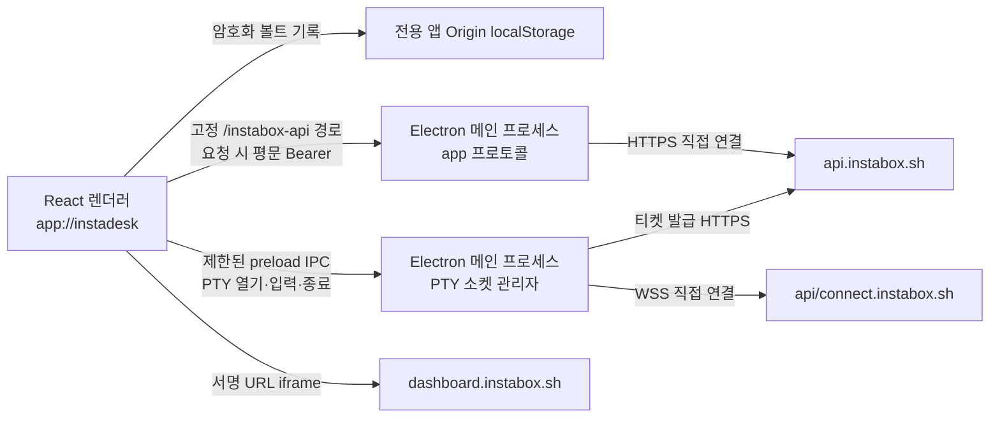

# InstaBox Deck Electron 전환 설계

2026-11-01 · **결정:** Windows x64 설치형 앱. 기존 React/Neo-Swiss 화면과 AES-GCM/PBKDF2 볼트 형식은 재사용한다. GitHub Pages와 Cloudflare Worker는 앱 검증 후 게시를 중단한다.

## 실행 구조

- 렌더러는 **번들된 로컬 파일만** 전용 `app://instadesk` 보안 Origin에서 실행한다. Web Crypto로 암호화된 키는 해당 앱 Origin의 localStorage에 저장한다. 마스터 비밀번호와 평문 키는 영구 저장하지 않는다. 이전 GitHub Pages Origin의 볼트는 자동으로 이전하지 않는다.
- REST/SSE는 메인 프로세스가 `/instabox-api/v1/*`에 대한 `app://` 요청을 고정 `https://api.instabox.sh/v1/*`로 전달한다. 렌더러는 브라우저 CORS 없이 동일 앱 Origin을 호출하고, 메인은 키를 기록하지 않는다. 메인 프로세스는 경로·메서드·목적지·리다이렉트를 검증한다.
- PTY 액세스 티켓은 기존 REST 경로로 발급받고, 렌더러가 티켓 URL과 제한된 서브프로토콜을 IPC로 메인에 전달한다. 메인은 허용된 WSS 호스트·경로·서브프로토콜을 재검증하고 소켓을 연결한다. 잠금·프로필 제거 때 해당 소켓과 요청을 중단한다.
- Desktop iframe은 원격 서비스의 frame policy 및 토큰 형식에 영향을 받는다. Electron의 네트워크 경로로 자동 해결된다고 간주하지 않고 실제 허가된 키로 확인한다. 원격 프레임은 Node/Electron 권한을 받지 않는다.

## 보안 경계

- BrowserWindow: `contextIsolation: true`, `nodeIntegration: false`, `sandbox: true`, `webSecurity: true`. 임의 웹 탐색·새 창·권한 요청을 기본 거부하고, 허용된 외부 Desktop 링크만 기본 브라우저로 연다. 제한된 contextBridge API만 노출한다.
- API 키는 렌더러의 볼트에서 요청 시 복호화되어 로컬 메인 프로세스로 전달된다. 메인 프로세스는 요청을 끝내면 키를 보관하지 않는다. 이는 저장 암호화이며 실행 중 렌더러 악성 코드까지 방어한다는 주장은 하지 않는다.
- 앱이 `app://instadesk` Origin을 독점하며 Pages의 다른 프로젝트 경로와 저장소를 공유하지 않는다. 정적 자산 프로토콜은 패키지의 빌드 디렉터리 밖 경로를 거부한다.
- Windows EXE는 Electron 공식 수동 배포 구조(`resources/app`)로 앱을 묶어 코드 서명 없는 포터블 ZIP으로 검증한다. `@electron/packager`의 현재 개발 의존성 권고를 피한다. SmartScreen/서명 신뢰와 macOS/Linux 배포는 별도 출고 게이트다.

## 사용 흐름과 상태

1. 앱 실행 → 볼트 초기화/해제 → 키 암호화 저장 → 메인 프로세스 API 조회 → VM 목록.
2. 키 검증/네트워크 실패는 암호화된 기록을 보존하고 원인 표시. 데모는 키 없이 동작.
3. 잠금/자동 잠금 → 진행 중 REST/SSE abort, PTY 종료, 서명 Desktop 뷰 제거. 외부 브라우저 탭과 서버 티켓의 원격 취소는 보장하지 않는다.
4. 앱 재실행 후 마스터 암호를 다시 요구한다. Pages에서 사용하던 키는 사용자가 앱에 재등록한다.

## 검증 게이트

고정 목적지·경로 탈출/리다이렉트 거부, API 401과 정상 목록 모의 응답, SSE 청크/취소, PTY 연결/종료/잠금, 볼트 재시작 후 복호화, 네이티브 BrowserWindow 설정과 app Origin, Windows x64 패키지 실행, 데모 UI를 확인한다. 유효한 실제 키의 REST·PTY·Desktop 및 장시간 사용은 권한이 있을 때 별도로 확인한다.
