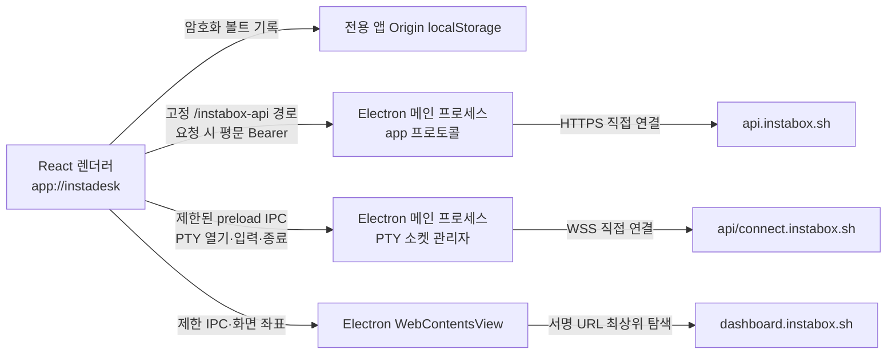

# InstaBox Deck Electron 전환 설계

2026-11-01 · **결정:** Windows x64 설치형 앱. 기존 React/Neo-Swiss 화면과 AES-GCM/PBKDF2 볼트 형식은 재사용한다. GitHub Pages와 개인 Cloudflare Worker 게시를 종료했다. 실 API/PTY/Desktop 수용은 별도 검증 중이다.

## 실행 구조

- 렌더러는 **번들된 로컬 파일만** 전용 `app://instadesk` 보안 Origin에서 실행한다. Web Crypto로 암호화된 키는 해당 앱 Origin의 localStorage에 저장한다. 마스터 비밀번호와 평문 키는 영구 저장하지 않는다. 이전 GitHub Pages Origin의 볼트는 자동으로 이전하지 않는다.
- REST/SSE는 메인 프로세스가 `/instabox-api/v1/*`에 대한 `app://` 요청을 고정 `https://api.instabox.sh/v1/*`로 전달한다. 렌더러는 브라우저 CORS 없이 동일 앱 Origin을 호출하고, 메인은 키를 기록하지 않는다. 메인 프로세스는 경로·메서드·목적지·리다이렉트를 검증한다.
- PTY 액세스 티켓은 기존 REST 경로로 발급받고, 렌더러가 티켓 URL과 서비스가 반환한 서브프로토콜·토큰을 IPC로 메인에 전달한다. 메인은 허용된 WSS 호스트·경로와 WebSocket 토큰 문법을 재검증한다. 서브프로토콜 이름은 서비스 응답에 따르며 티켓 토큰의 점(`.`)을 허용한다. 선택한 세션 이름은 URL의 `session` 쿼리로 보낸다. 잠금·프로필 제거 때 해당 소켓과 요청을 중단한다.
- 실제 Desktop 링크는 `dashboard.instabox.sh`가 `X-Frame-Options: DENY`와 `frame-ancestors 'none'`을 보내므로 iframe 대신 Electron의 별도 `WebContentsView`에 최상위 문서로 연다. 메인은 링크의 고정 HTTPS Origin과 화면 좌표를 검증한다. 원격 뷰에는 preload/Node 권한을 주지 않으며 앱 모달·잠금·프로필 제거 때 뷰를 닫는다. 실 키의 스트림 영상은 확인했고 마우스·키보드 입력은 별도 검증 대상이다.
- 실제 스트림용 네이티브 뷰는 가용 데스크톱 패널 전체를 차지한다. 서버 상태의 보고 해상도와 실제 스트림 framebuffer가 다를 수 있으므로, 앱이 보고 해상도로 외곽 높이를 제한하지 않는다. 대시보드가 실제 framebuffer 화면비를 유지하며 내부 canvas를 가용 영역에 맞춘다. 데모 미리보기는 기존 `fitDesktop` 계산을 사용한다.
- 대시보드 문서 로드가 끝난 뒤 뷰의 zoom factor를 명시적으로 1로 설정한다. Electron은 탐색 과정에서 이전 호스트 배율을 다시 적용할 수 있어 뷰 생성 직후의 설정만으로는 부족하다.
- VM이 `suspended`·`stopped` 등 실행 중이 아닌 상태이면 새 Desktop 링크를 열지 않고 현재 머신 상태와 재개 안내를 표시한다. 사용자가 사이드바에서 VM을 재개해 `running` 상태가 확인되면 링크를 다시 발급한다.
- 앱은 중복 인스턴스를 막고 기존 창을 전면으로 올린다. 개발 실행과 패키지도 같은 사용자 데이터 위치에 접근할 수 있으므로 동시에 실행하지 않는다. 실제로 병행 실행 때 Chromium 캐시 잠금 오류가 관찰되어 볼트 저장소 보호가 필요하다.

## 보안 경계

- BrowserWindow: `contextIsolation: true`, `nodeIntegration: false`, `sandbox: true`, `webSecurity: true`. 임의 웹 탐색·새 창·권한 요청을 기본 거부하고, 허용된 외부 Desktop 링크만 기본 브라우저로 연다. 제한된 contextBridge API만 노출한다.
- API 키는 렌더러의 볼트에서 요청 시 복호화되어 로컬 메인 프로세스로 전달된다. 메인 프로세스는 요청을 끝내면 키를 보관하지 않는다. 이는 저장 암호화이며 실행 중 렌더러 악성 코드까지 방어한다는 주장은 하지 않는다.
- 앱이 `app://instadesk` Origin을 독점하며 Pages의 다른 프로젝트 경로와 저장소를 공유하지 않는다. 정적 자산 프로토콜은 패키지의 빌드 디렉터리 밖 경로를 거부한다.
- Windows x64와 Linux x64·arm64는 Electron 공식 수동 배포 구조(`resources/app`)로 앱을 묶는다. 각 네이티브 CI runner에서 Windows ZIP 또는 Linux tar.gz를 만들고 실행 아키텍처·자산·headless GUI 로드를 확인한다. `@electron/packager`의 현재 개발 의존성 권고를 피한다. 코드 서명/SmartScreen, 다른 Linux 배포판과 물리 ARM 기기는 별도 게이트다.

## 사용 흐름과 상태

1. 앱 실행 → 볼트 초기화/해제 → 키 암호화 저장 → 메인 프로세스 API 조회 → VM 목록.
2. 키 검증/네트워크 실패는 암호화된 기록을 보존하고 원인 표시. 데모는 키 없이 동작.
3. 잠금/자동 잠금 → 진행 중 REST/SSE abort, PTY 종료, 서명 Desktop 뷰 제거. 외부 브라우저 탭과 서버 티켓의 원격 취소는 보장하지 않는다.
4. 앱 재실행 후 마스터 암호를 다시 요구한다. Pages에서 사용하던 키는 사용자가 앱에 재등록한다.

## 검증 게이트

고정 목적지·경로 탈출/리다이렉트 거부, API 401과 정상 목록 모의 응답, SSE 청크/취소, PTY 연결/종료/잠금, 볼트 재시작 후 복호화, 네이티브 BrowserWindow 설정과 app Origin, 세 아키텍처의 패키지 로드·데모 UI를 확인한다. Windows x64의 실 키 목록·PTY·Desktop 화면 맞춤은 2.0.6에서 확인했다. Linux 실 키·실 ARM 기기·장시간 사용은 별도 조건이다.
